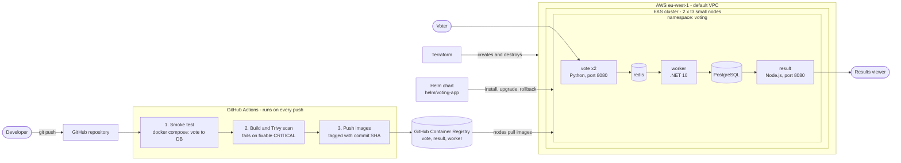

# Example Voting App: DevOps Capstone 1

This is my fork of [dockersamples/example-voting-app](https://github.com/dockersamples/example-voting-app), taken through the full DevOps path for Capstone 1: run it locally, containerize it safely, build the infrastructure with Terraform, ship it with a CI pipeline, and deploy it to Kubernetes with Helm (including a deliberate bad release and a rollback).

Author: Azuka Ekenedilichukwu. Branch with all the work: `capstone1-container-hardening` (merged into `main`).

**How the app works:** a person votes in `vote` (Python) → the vote goes into `redis` → `worker` (.NET) reads it and writes it to `db` (PostgreSQL) → `result` (Node.js) shows the live count.

## Architecture



## Repository layout

| Path | What it is |
| --- | --- |
| `vote/`, `result/`, `worker/` | The three services, each with a hardened `Dockerfile` |
| `docker-compose.yml` | Runs the whole app locally |
| `ci/` | Compose file and smoke-test script used by the pipeline |
| `.github/workflows/ci.yml` | The GitHub Actions pipeline |
| `terraform/` | Builds the EKS cluster on AWS |
| `helm/voting-app/` | The one Helm chart and its one `values.yaml` |

## Step 1: Run it locally

```bash
docker compose up --build
```

Vote at http://localhost:8080 and watch the result at http://localhost:8081. Stop it with `docker compose down -v`.

## Step 2: Containers, hardened

- **Pinned base images:** every `FROM` line is pinned by digest (`python:3.11-slim`, `node:22-slim`, .NET 10 SDK and runtime), so a build today and a build next month use the same bytes.
- **Not root:** `vote`, `result` and `worker` run as user ID `10001`. Because a non-root user cannot use ports below 1024 on Kubernetes, the services listen on port 8080.
- **Multi-stage builds** keep build tools out of the final images, and each service has a `.dockerignore`.
- Every image builds and starts, and the full flow works end to end.

## Step 3: Infrastructure with Terraform

`terraform/` creates an EKS cluster (Kubernetes 1.34) with a managed node group of 2 x `t3.small`, in the **default VPC** of `eu-west-1`, plus the IAM roles it needs. That is 8 resources.

```bash
cd terraform
export AWS_PROFILE=<your-aws-profile>
terraform init
terraform plan -out=tfplan
terraform apply tfplan
aws eks update-kubeconfig --region eu-west-1 --name voting-app-cluster
kubectl get nodes
terraform destroy      # removes everything, so nothing keeps billing
```

I built the cluster, destroyed it, and rebuilt it again from this code. State files and plans are git-ignored; `.terraform.lock.hcl` is committed.

## Step 4: CI pipeline (GitHub Actions)

Every push runs `.github/workflows/ci.yml`:

1. **Smoke test:** starts the whole app with `docker compose`, casts a vote, and checks it reaches the PostgreSQL table.
2. **Build:** builds `vote`, `result` and `worker` (matrix job) and keeps each image local.
3. **Trivy scan:** the build fails if an image has a **fixable CRITICAL** vulnerability. A HIGH/CRITICAL report is printed for information.
4. **Push:** only an image that passed the scan is pushed to GitHub Container Registry, tagged with the short and full commit SHA:
   `ghcr.io/azuka-ekene/example-voting-app-{vote,result,worker}:<sha>`

Security choices in the pipeline: the job uses the built-in `GITHUB_TOKEN` (no stored secrets), permissions are least-privilege, and every third-party action is pinned to a full commit SHA. The Trivy action is pinned on purpose, because most of its version tags were hijacked in a March 2026 supply-chain attack.

Problems the scan found and I fixed: a critical `proxy-addr` flaw in the `result` npm lockfile, an end-of-life .NET 7 base image for `worker` (moved to .NET 10), and CVE-2021-24112 in `System.Drawing.Common` (pinned to 5.0.3). I also deleted the upstream workflows, which pushed to the original authors' registries.

## Step 5: Deploy with Helm, break it, roll back

One chart (`helm/voting-app`) and one values file deploy all five components into the `voting` namespace. The three app containers run as non-root with no extra privileges. The `redis` and `db` services are named exactly that because the sample app looks for those host names.

```bash
# install (use the short commit SHA of a green pipeline run)
helm install voting-app helm/voting-app --set image.tag=<short-sha> \
  --namespace voting --create-namespace --wait --timeout 5m
kubectl -n voting get pods

# reach the app without an ingress
kubectl -n voting port-forward svc/vote 8080:80
kubectl -n voting port-forward svc/result 8081:80

# ship a bad release on purpose: an image tag that does not exist
helm upgrade voting-app helm/voting-app --set image.tag=<short-sha> \
  --set vote.tag=this-tag-does-not-exist --namespace voting --wait --timeout 60s

# roll back to the last good revision
helm history voting-app -n voting
helm rollback voting-app <good-revision> -n voting --wait
```

The bad release shows how a rolling update protects users: the new `vote` pod cannot start, but Kubernetes keeps the old pods running, so the site stays up until the rollback.

## Evidence from my runs

Cluster built from code:

```
Apply complete! Resources: 8 added, 0 changed, 0 destroyed.

NAME                                         STATUS   ROLES    AGE   VERSION
ip-172-31-16-92.eu-west-1.compute.internal   Ready    <none>   14m   v1.34.12-eks-39aca56
ip-172-31-33-23.eu-west-1.compute.internal   Ready    <none>   14m   v1.34.12-eks-39aca56
```

Healthy release (6 pods running):

```
NAME                      READY   STATUS    RESTARTS   AGE
db-f7bf8fc96-sqmdj        1/1     Running   0          28s
redis-78678b78b4-tg9lw    1/1     Running   0          28s
result-76766d5cc5-sfn65   1/1     Running   0          28s
vote-747fc5589b-8zlpv     1/1     Running   0          28s
vote-747fc5589b-jkrv5     1/1     Running   0          28s
worker-6dfb4b6ff8-ttjjp   1/1     Running   0          28s
```

Deliberately bad release: the new `vote` pod cannot pull its image, and the old pods keep serving.

```
Error: UPGRADE FAILED: context deadline exceeded

NAME                      READY   STATUS             RESTARTS   AGE
db-f7bf8fc96-sqmdj        1/1     Running            0          10m
redis-78678b78b4-tg9lw    1/1     Running            0          10m
result-76766d5cc5-sfn65   1/1     Running            0          10m
vote-5bf88d95c5-68hgz     0/1     ImagePullBackOff   0          72s
vote-747fc5589b-8zlpv     1/1     Running            0          10m
vote-747fc5589b-jkrv5     1/1     Running            0          10m
worker-6dfb4b6ff8-ttjjp   1/1     Running            0          10m
```

After `helm rollback`, the release is healthy again (revision 5 is the rollback; revisions 2 and 4 are the failed bad releases):

```
REVISION   STATUS       DESCRIPTION
1          superseded   Install complete
2          failed       Upgrade "voting-app" failed: context deadline exceeded
3          superseded   Rollback to 1
4          failed       Upgrade "voting-app" failed: context deadline exceeded
5          deployed     Rollback to 3
```

## Security notes: no secrets in Git

- No access keys, tokens or passwords for AWS or GitHub are stored in the repository. AWS credentials live only in my local AWS profile. The pipeline uses the temporary `GITHUB_TOKEN`.
- Terraform state (`*.tfstate`), plans and `*.tfvars` are git-ignored.
- The `postgres`/`postgres` login is a throwaway test credential that the upstream sample app hard-codes in its source (`worker/Program.cs`, `result/server.js`). It protects no real data, and the database is not reachable from outside the cluster.

## Known limits

- The database uses an `emptyDir` volume, so votes are lost if the database pod restarts. That is fine for a demo, and a real system would use a persistent volume.
- The app is reached with `kubectl port-forward`, so there is no public load balancer or ingress. Optional stretch goals (ingress, remote Terraform state, Argo CD, autoscaling) were left out on purpose.
- The cluster is destroyed after use to avoid AWS charges; `terraform apply` rebuilds it from code in about 15 minutes.
